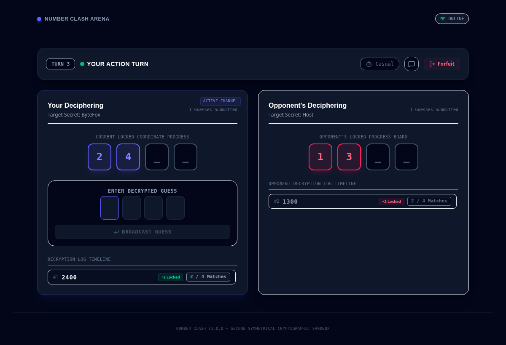
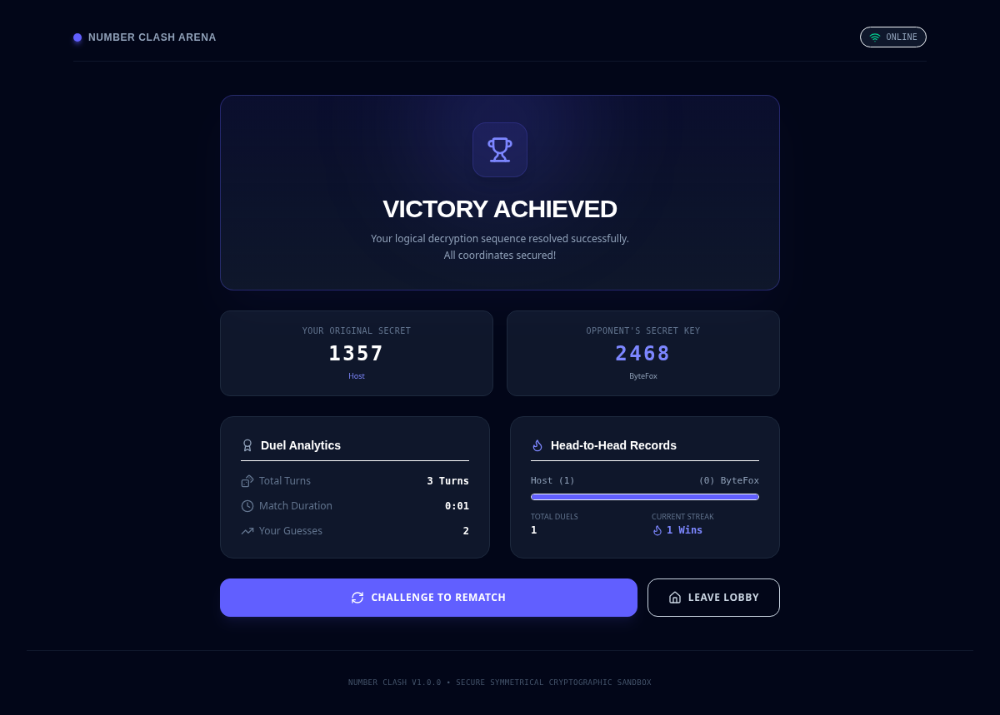

# Number Clash

Number Clash is a real-time, competitive, multiplayer 4-digit number-guessing web game. Players challenge opponents in structured, fast-paced duels where deductive reasoning, tactical thinking, and speed are key.

The React 19 client connects to a Node.js and Socket.IO server. Open the app in two separate browser profiles, or in a regular and a private window. Create a room in one and join using its code in the other. Two regular tabs in the same profile share the local player session.

---

## Demo





*Captured during a local game with demo identities. The browser trial covered room creation and joining, locking in secret numbers, scoring, synchronizing both players, reconnecting after reload, completing the game, and a rematch. Type checking and the production build also passed.*

## 🚀 Key Features

*   **Authoritative Backend:** The server validates guesses, coordinates turns, and keeps secrets hidden until the match is decided.
*   **Auto-Advancing Input Grid:** A smooth, auto-focusing 4-digit input layout optimized for rapid typing on desktop and mobile.
*   **Connection Resilience:** A 120-second backend grace period allows disconnected players to reconnect and restore active sessions.
*   **Head-to-Head Statistics:** The server tracks head-to-head results in memory. Rooms, sessions, and stats are lost when the server restarts. PostgreSQL is a design proposal, not a runtime dependency of this version.
*   **Polished Dark Theme:** A slate-colored theme designed for long thinking sessions, with transitions powered by `motion/react`.

---

## 📁 System Documentation Directory

The complete architecture, design specs, and roadmaps are stored in the `/docs` directory:

1.  **[01_GAME_RULES.md](docs/01_GAME_RULES.md)** — Core deduction algorithms, feedback, and turn timers.
2.  **[02_SYSTEM_ARCHITECTURE.md](docs/02_SYSTEM_ARCHITECTURE.md)** — Network topologies, state machines, and load scaling.
3.  **[03_DATABASE_SCHEMA.md](docs/03_DATABASE_SCHEMA.md)** — Proposed persistent database models, head-to-head stats, and index strategies.
4.  **[04_SOCKET_EVENTS.md](docs/04_SOCKET_EVENTS.md)** — Complete Socket.IO event payloads, validations, and flows.
5.  **[05_UI_SPEC.md](docs/05_UI_SPEC.md)** — Visual design, layout specifications, and animation values.
6.  **[06_BACKEND_SPEC.md](docs/06_BACKEND_SPEC.md)** — Server class structures, zero-trust token validation, and rate limiters.
7.  **[07_FRONTEND_SPEC.md](docs/07_FRONTEND_SPEC.md)** — State routing context, custom hooks, and screen managers.
8.  **[08_TESTING.md](docs/08_TESTING.md)** — Unit test matrices, socket integration scripts, and manual QA cases.
9.  **[09_ROADMAP.md](docs/09_ROADMAP.md)** — Release milestones, launch criteria, and quality gates.
10. **[10_BACKLOG.md](docs/10_BACKLOG.md)** — MoSCoW backlog and task prioritization trackers.

*For a high-level summary of system-wide architectural decisions, see **[ARCHITECTURE.md](ARCHITECTURE.md)**.*

---

## 🛠️ Developer Setup & Commands

### Prerequisites
*   **Node.js** and **npm**. Use Node.js 22 for local setup.

### Installation
Clone the repository and install all dependencies:
```bash
npm install
```

### Environment Configuration
The local app defaults to port 3000. To use a different port, set `PORT` in a local `.env` file:
```env
PORT=3000
```

### Run Commands

*   **Development Server:** Starts the server with Vite development middleware. Open `http://localhost:3000` using the default port.
    ```bash
    npm run dev
    ```
*   **Build Production:** Compiles production assets for static hosting and packs the backend.
    ```bash
    npm run build
    ```
*   **Start Production Server:** Launches the compiled Express production server.
    ```bash
    npm start
    ```
*   **Linting:** Runs the TypeScript type checker.
    ```bash
    npm run lint
    ```
*   **Local simulation:** With the development server running on port 3000, run the Socket.IO simulation in a second terminal:
    ```bash
    npx tsx simulate.ts
    ```
    The repository also includes [a larger simulation](simulate_hundreds.ts) and [a testing guide](docs/08_TESTING.md).


