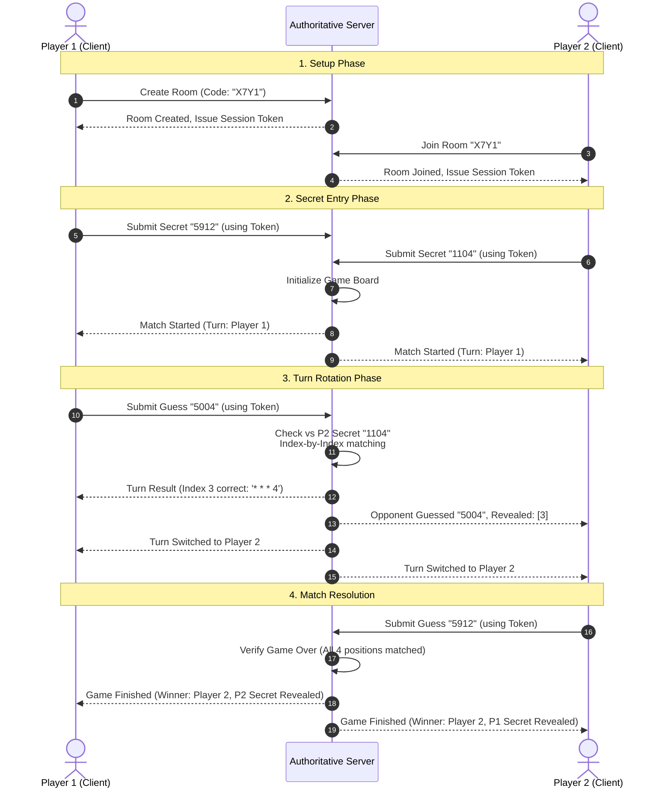

# 00_PROJECT_OVERVIEW

## 1. Document Control & Metadata

| Field | Value |
| :--- | :--- |
| **Document ID** | NC-DOC-00 |
| **Title** | Project Overview |
| **Version** | 1.0.0 |
| **Status** | Approved / Frozen for v1 |
| **Last Updated** | 2026-07-09 |
| **Author** | Senior Software Architect & Systems Designer |
| **Target Audience** | Engineering Team, QA Analysts, Stakeholders, AI Coding Assistants |

---

## 2. Executive Summary & Purpose

### 2.1 Purpose
The purpose of this document is to establish the high-level vision, core philosophy, and foundational guidelines for **Number Clash**, a real-time, competitive, two-player multiplayer web game. This document serves as the entry point and structural map for the entire Number Clash engineering documentation repository. It aligns all downstream implementation details with the project's core objectives and ensures zero architectural drift during construction.

### 2.2 Product Vision
Number Clash is designed to be the cleanest, fastest, and most engaging competitive number-guessing game on the modern web. It provides an elegant, distraction-free environment where two opponents can match wits in real-time. By utilizing an authoritative server and simple, deep mechanics, Number Clash strips away the unnecessary clutter of typical modern mobile games and focuses purely on competitive, tactical gameplay.

---

## 3. Scope of Version 1 (v1.0.0)

The scope of Version 1 is strictly capped to deliver a highly polished, resilient, and responsive core game loop. It avoids feature bloat and over-engineering to guarantee an immediate, stable release.

### 3.1 In-Scope Features
*   **Authoritative Server-Client Architecture:** Powered by Express, Node.js, and Socket.IO, with absolute server authority over game state, feedback generation, turn order, and timers.
*   **Real-Time Multiplayer Play:** Instant 1v1 matchmaking utilizing unique, shareable room codes.
*   **Position-Only Feedback Engine:** A clean mathematical algorithm that evaluates guesses and reveals only newly correct digits in their correct positions.
*   **Automatic Turn Timer Action:** Configurable match timers (30s, 60s, 90s, or None) that automatically skip a player's turn upon expiration to maintain active, non-griefing gameplay.
*   **State-Saving Reconnection System:** A robust 120-second grace period that allows players to disconnect and resume their exact game state without forfeit.
*   **Durable Cloud-Aided Guest Play:** Guest session persistence via Prisma and PostgreSQL, allowing instant play without upfront registration barriers.
*   **Canonicalized Head-to-Head Statistics:** Multi-session history tracking stored canonically using sorted player IDs, ensuring consistent metrics regardless of match configuration.
*   **Modern, Eye-Safe Dark Interface:** A desktop-optimized, mobile-first responsive design featuring smooth transitions, micro-animations, and structured data layouts.

### 3.2 Out-of-Scope (Post-v1 / Backlog)
*   **Full User Account Registration:** Handled via secure, passworded authentication or OAuth providers (slated for Phase 6).
*   **AI Opponents / Practice Mode:** Computer-controlled players mimicking different human behaviors.
*   **Ranked Ladder & Public Matchmaking:** Global lobbies, matchmaking queues, Elo-based ranks, and seasonal leaderboards.
*   **Spectator Mode:** Real-time visual tracking of matches by third-party observers.
*   **Custom Interface Themes & Cosmetics:** Visual customizations, boards, and sound packages.
*   *For a complete catalog of post-v1 extensions, refer to* [10_BACKLOG.md](10_BACKLOG.md).

---

## 4. Architectural & Product Principles

Every implementation decision must satisfy these six immutable principles. If a proposed design violates any of these, it must be rejected.

```
┌────────────────────────────────────────────────────────────────────────┐
│                        CORE PROJECT PRINCIPLES                         │
├────────────────────────────────────────────────────────────────────────┤
│  1. Authoritative Server  ───► Server owns all state and feedback      │
│  2. Gameplay Integrity    ───► No Bulls & Cows or extra guess hints    │
│  3. Frictionless Access   ───► Instant guest entry, fast room sharing  │
│  4. Mobile-First Form     ───► Touch targets ≥ 44px, adaptive layout   │
│  5. Extreme Resilience    ───► 120s grace period for bad connections   │
│  6. Scoped Discipline     ───► Ship v1 before introducing additions    │
└────────────────────────────────────────────────────────────────────────┘
```

1.  **The Server is the Single Source of Truth:** The client is purely a visual rendering and input collection shell. It stores no hidden secrets, performs no game logic calculations, and cannot override turn parameters.
2.  **Preserve Original Position-Only Gameplay:** No Bulls & Cows elements (e.g., indicating a correct number in the wrong position) are allowed. The mechanics must match the frozen gameplay spec exactly.
3.  **Frictionless Access:** Players must be able to launch the app, create or join a room, and start playing within three clicks. Guest-first access is critical.
4.  **Mobile-First Responsive Form:** The UI must feel native and performant on mobile viewports while remaining spacious and elegant on wide desktop monitors.
5.  **Extreme Resilience:** Mobile network degradation and accidental tab closures must not ruin a competitive match. Connection recovery must be seamless.
6.  **Strict Scope Discipline:** Finish the core Version 1 spec with elite craftsmanship before beginning any backlog items.

---

## 5. Core Game Rules Summary

*   **Setup:** Two players join a room. Each secretly inputs a 4-digit secret key (ranges from `0000` to `9999`). Leading zeros and duplicate digits are completely valid.
*   **Gameplay:** Players alternate turns submitting 4-digit guesses.
*   **Feedback:** The server checks the guess against the opponent's secret index-by-index. It reveals and locks *only* the newly discovered digits that are correct in value *and* correct in position. Previously revealed positions are never re-announced.
*   **Victory:** The first player to successfully lock all four digits of their opponent's secret key wins.
*   *For the complete detailed specifications of the feedback engine and edge cases, see* [01_GAME_RULES.md](01_GAME_RULES.md).

---

## 6. Key Definitions & Terminology

*   **Secret Key:** The private 4-digit string picked by a player at the start of a match.
*   **Position-Only Match:** A match where feedback only indicates correct numbers in correct positions (index-by-index matching).
*   **Discovered Position:** A position (index 0 to 3) in the opponent's secret key that has already been guessed correctly by the player.
*   **Automatic Skip (Timeout):** The automated action taken by the server when a player's turn timer runs out, advancing turn ownership to the other player.
*   **Consecutive Timeout Limit:** Three (3) consecutive automatic skips by the same player. Exceeding this gives the opponent an immediate early victory option.
*   **Canonical Pairing:** The practice of sorting two player IDs lexicographically (smaller ID as Key 1, larger as Key 2) to store and retrieve historical records in a single database row, regardless of which player initiated the lobby.
*   **Reconnect Grace Period:** A 120-second active window during which a disconnected player's slot, state, and timer are paused on the server, permitting full restoration upon reconnection.

---

## 7. Document Registry & Repository Map

To navigate the engineering documentation set, use the map below. Each document is a self-contained specification designed to be immediately actionable.

```
                                  [00_PROJECT_OVERVIEW]
                                            │
         ┌──────────────────────────────────┼──────────────────────────────────┐
         ▼                                  ▼                                  ▼
   [01_GAME_RULES]                [02_SYSTEM_ARCHITECTURE]               [05_UI_SPEC]
         │                                  │                                  │
         ├─────────────────┐                ├─────────────────┐                │
         ▼                 ▼                ▼                 ▼                ▼
   [08_TESTING]     [10_BACKLOG]     [03_DATABASE_SCHEMA] [04_SOCKET_EVENTS] [07_FRONTEND_SPEC]
                                            │                 │
                                            ▼                 ▼
                                     [06_BACKEND_SPEC] ◄──────┘
                                            │
                                            ▼
                                      [09_ROADMAP]
```

*   **[00_PROJECT_OVERVIEW.md](00_PROJECT_OVERVIEW.md):** *This document.* High-level vision, scope boundaries, core principles, vocabulary, and document map.
*   **[01_GAME_RULES.md](01_GAME_RULES.md):** Precise, mathematical definitions of the feedback loop, turn transitions, timer rules, victory states, and detailed sequence diagrams.
*   **[02_SYSTEM_ARCHITECTURE.md](02_SYSTEM_ARCHITECTURE.md):** High-level architectural diagrams, server authority model, socket lifecycles, service boundaries, directory structure, and deployment model.
*   **[03_DATABASE_SCHEMA.md](03_DATABASE_SCHEMA.md):** Production Prisma schema, entity relationship diagrams (ERD), index strategies, and sample records.
*   **[04_SOCKET_EVENTS.md](04_SOCKET_EVENTS.md):** Rigid schema contracts for client-server and server-client real-time communication events, complete with payloads, validations, errors, and sequence diagrams.
*   **[05_UI_SPEC.md](05_UI_SPEC.md):** High-fidelity component structures, user experience maps, responsive visual frames, keyboard layouts, and micro-animations.
*   **[06_BACKEND_SPEC.md](06_BACKEND_SPEC.md):** Internal modular service specs (Room Manager, Turn Engine, Session/Auth, Reconnect/Grace, TTL cleaner), database repository layer, and rate-limiting rules.
*   **[07_FRONTEND_SPEC.md](07_FRONTEND_SPEC.md):** Client-side architecture: state managers, React hooks, connection boundaries, and local state synchronizers.
*   **[08_TESTING.md](08_TESTING.md):** Automated testing blueprints, unit test matrices, socket integration scripts, and manual QA flowcharts.
*   **[09_ROADMAP.md](09_ROADMAP.md):** Modular execution plan, milestone metrics, and detailed task breakdowns for Phase 1 through Phase 6.
*   **[10_BACKLOG.md](10_BACKLOG.md):** Organized list of out-of-scope candidate features for future releases, preserved to avoid Scope Creep during Version 1.
*   **[ARCHITECTURE.md](../ARCHITECTURE.md):** Quick-reference guide summarizing system patterns and folder rules for immediate developer onboarding.
*   **[README.md](../README.md):** Standard installation, dependency, execution, build, and contribution instructions.

---

## 8. High-Level Gameplay Interaction Flow

Below is a Mermaid sequence showing the high-level lifetime of a single game inside a room, illustrating the authoritative role of the backend.



---

## 9. Major Decisions Frozen for v1

The following table summarizes the four core decisions locked in for Version 1, preventing design drift during developer execution.

| Decision ID | Area | Frozen Resolution | Architectural Justification |
| :--- | :--- | :--- | :--- |
| **DEC-001** | **Feedback Logic** | Position-Only (Direct Index-by-Index Matching) | Eliminates complexity surrounding matching counts (Bulls). Simplifies edge-case checking, makes automated testing reliable, and presents a direct mathematical challenge to the player. |
| **DEC-002** | **Connection Resilience** | 120-Second Active Grace Period | Prevents accidental client refreshes or standard mobile handoff dropouts (LTE to Wi-Fi) from triggering a default defeat. Balance between player recovery and opponent downtime. |
| **DEC-003** | **Identity/Accounts** | Guest-First Database Schema (Nullable `userId`) | Promotes friction-free onboarding. Allows immediate gameplay with database logging, but contains pre-built foreign key relationships (`userId` in `RoomPlayer`) to support standard auth later. |
| **DEC-004** | **Database Storage** | Canonical Key Ordering (`BattleStats`) | Lexicographically sorts player keys (e.g., `user_abc` is always Player 1 Key, `user_xyz` is always Player 2 Key). Prevents duplicate row creation and simplifies multi-game aggregations. |
| **DEC-005** | **Timer Resolution** | Automatic Server-Initiated Turn Skips | Turns are automatically skipped by the server upon timeout, which prevents stall conditions and guarantees active progression without requiring manual input from the waiting opponent. |

---

## 10. Document References

*   *Detailed validation constraints on inputs:* [01_GAME_RULES.md](01_GAME_RULES.md)
*   *Implementation plans for DB structure:* [03_DATABASE_SCHEMA.md](03_DATABASE_SCHEMA.md)
*   *Detailed event specifications:* [04_SOCKET_EVENTS.md](04_SOCKET_EVENTS.md)
