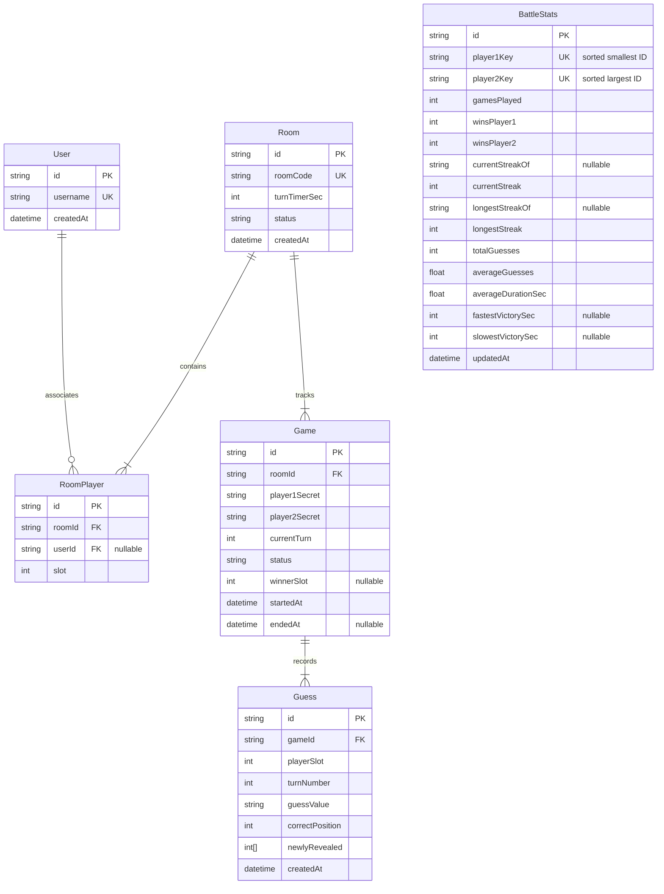

# 03_DATABASE_SCHEMA

## 1. Document Control & Metadata

| Field | Value |
| :--- | :--- |
| **Document ID** | NC-DOC-03 |
| **Title** | Relational Database Schema & Data Models |
| **Version** | 1.0.0 |
| **Status** | Approved / Frozen for v1 |
| **Last Updated** | 2026-07-09 |
| **Author** | Senior Software Architect & Systems Designer |
| **Target Audience** | Database Administrators, Backend Developers, Data Engineers |

---

## 2. Executive Summary & Purpose

### 2.1 Purpose
This document defines the physical data schema, database relations, indexing strategies, constraints, and initial migration pathways for **Number Clash**. It guarantees that the persistent state of the application is clean, highly queryable, and resilient to typical race conditions or integrity issues.

### 2.2 Relational Design Goals
While Number Clash functions primarily in real-time, persistent storage is vital for game history tracking, head-to-head match stats, and guest sessions. The database layer is designed using **PostgreSQL via Prisma ORM**. This enables smooth, type-safe data access and solid transaction boundaries.

---

## 3. Entity-Relationship Diagram (ERD)

The relational structure is illustrated in the Mermaid ERD below. Note the nullable relationships built to support optional guest sessions and seamless future migrations.



---

## 4. Authoritative Prisma Schema Specification

The following is the definitive Prisma Schema definition, containing explicit foreign-key referential actions (`onDelete: Cascade` where logical to prevent orphaned records).

```prisma
datasource db {
  provider = "postgresql"
  url      = env("DATABASE_URL")
}

generator client {
  provider = "prisma-client-js"
}

/// Representing either a registered User or persistent Guest session
model User {
  id         String       @id @default(cuid())
  username   String?      @unique
  createdAt  DateTime     @default(now())
  players    RoomPlayer[]

  @@map("users")
}

/// An active or historical room, serving as the communication hub for two players
model Room {
  id           String       @id @default(cuid())
  roomCode     String       @unique
  turnTimerSec Int?         // null = No Timer. Allowed: 30, 60, 90.
  status       RoomStatus   @default(CREATED)
  createdAt    DateTime     @default(now())
  players      RoomPlayer[]
  games        Game[]

  @@map("rooms")
}

/// Pivot model connecting physical users/guests to rooms in active slots (1 or 2)
model RoomPlayer {
  id       String  @id @default(cuid())
  roomId   String
  room     Room    @relation(fields: [roomId], references: [id], onDelete: Cascade)
  userId   String? // Nullable to support instant guest lobbies without account setup
  user     User?   @relation(fields: [userId], references: [id], onDelete: SetNull)
  slot     Int     // Must be strictly evaluated as 1 or 2 on the server

  @@unique([roomId, slot]) // Prevents two players from occupying the same slot
  @@unique([roomId, userId]) // Prevents a single user from occupying both slots
  @@map("room_players")
}

/// An individual match instance played inside a specific room
model Game {
  id            String     @id @default(cuid())
  roomId        String
  room          Room       @relation(fields: [roomId], references: [id], onDelete: Cascade)
  player1Secret String     // 4-digit secret key for Player 1
  player2Secret String     // 4-digit secret key for Player 2
  currentTurn   Int        @default(1) // Tracks current turn count
  status        GameStatus @default(IN_PROGRESS)
  winnerSlot    Int?       // Nullable. Evaluated as 1 or 2 upon victory.
  startedAt     DateTime   @default(now())
  endedAt       DateTime?  // Updated when match reaches FINISHED or ABANDONED state
  guesses       Guess[]

  @@map("games")
}

/// Individual guess records submitted sequentially during active gameplay
model Guess {
  id              String   @id @default(cuid())
  gameId          String
  game            Game     @relation(fields: [gameId], references: [id], onDelete: Cascade)
  playerSlot      Int      // 1 or 2 (which player submitted the guess)
  turnNumber      Int      // Sequence turn indicator
  guessValue      String   // Validated 4-digit string
  correctPosition Int      // Count of correct positions locked by this guess (0 to 4)
  newlyRevealed   Int[]    // Array of indices newly revealed (e.g., [1, 3])
  createdAt       DateTime @default(now())

  @@map("guesses")
}

/// Symmetrical Head-to-Head Battle Statistics between two users
model BattleStats {
  id                 String   @id @default(cuid())
  player1Key         String   // Canonicalized: Always lexicographically smaller user ID
  player2Key         String   // Canonicalized: Always lexicographically larger user ID
  gamesPlayed        Int      @default(0) // Only completed games (excludes ABANDONED)
  winsPlayer1        Int      @default(0) // Total wins for Player 1
  winsPlayer2        Int      @default(0) // Total wins for Player 2
  currentStreakOf    String?  // ID of the user currently holding a streak
  currentStreak      Int      @default(0) // Length of active streak
  longestStreakOf    String?  // ID of the user holding the record streak
  longestStreak      Int      @default(0) // Length of longest streak
  totalGuesses       Int      @default(0) // Combined guesses across all completed games
  averageGuesses     Float    @default(0) // Combined guesses / completed games
  averageDurationSec Float    @default(0) // Combined duration / completed games
  fastestVictorySec  Int?     // Shortest victory duration in seconds
  slowestVictorySec  Int?     // Longest victory duration in seconds
  updatedAt          DateTime @updatedAt

  @@unique([player1Key, player2Key]) // Guarantees exactly one stats row per pairing
  @@map("battle_stats")
}

enum RoomStatus {
  CREATED
  WAITING_FOR_PLAYER
  READY
  PLAYING
  GAME_FINISHED
  REMATCH_PENDING
  CLOSED
}

enum GameStatus {
  IN_PROGRESS
  FINISHED
  ABANDONED
}
```

---

## 5. Relationships & Constraints

### 5.1 Relational Integrity Rules
*   **Cascade Deletions:** If a `Room` is explicitly deleted or pruned by the TTL cleaner service, all related `RoomPlayer` pivot states and `Game` records must be cascaded (`onDelete: Cascade`). This prevents persistent storage leakages and orphaned records.
*   **Cascading Guess Deletions:** If a `Game` record is removed, its dependent `Guess` records must cascade-delete automatically.
*   **User Safe Preservation:** If a `User` profile is deleted, any historical `RoomPlayer` pivot row preserves its existence but updates `userId` to `NULL` (`onDelete: SetNull`). This preserves match history trees without corrupting foreign key constraints.

### 5.2 Unique Index and Constraints Table
Below is the database index optimization strategy configured to guarantee high performance and data integrity under concurrent load.

| Table Name | Constraint / Index Type | Columns Involved | Goal / Rationale |
| :--- | :--- | :--- | :--- |
| `users` | Unique Index | `username` | Ensures no two active players can secure identical usernames. |
| `rooms` | Unique Index | `roomCode` | Prevents room collision during generation (6-character codes). |
| `room_players` | Unique Composite | `[roomId, slot]` | Guarantees room occupancy is strictly capped at two players (Slot 1 and Slot 2). |
| `room_players` | Unique Composite | `[roomId, userId]` | Prevents the same user from joining as both Player 1 and Player 2 in the same room. |
| `battle_stats` | Unique Composite | `[player1Key, player2Key]` | Ensures head-to-head records between the same two users are merged into a single database row. |

---

## 6. Symmetrical Database Examples

The following records demonstrate how game state translates into physical PostgreSQL rows.

### 6.1 Sample `User` Record (Player 1 & Player 2)
```json
[
  {
    "id": "usr_cl80ab123x0001",
    "username": "AlphaGamer",
    "createdAt": "2026-07-09T20:00:00.000Z"
  },
  {
    "id": "usr_cl80ab999y0002",
    "username": "BetaStriker",
    "createdAt": "2026-07-09T20:05:00.000Z"
  }
]
```

### 6.2 Sample `Room` & `RoomPlayer` Records (Active Match)
*   **`rooms` Table:**
```json
{
  "id": "rm_cl80rm999x0001",
  "roomCode": "NX8F92",
  "turnTimerSec": 60,
  "status": "PLAYING",
  "createdAt": "2026-07-09T21:00:00.000Z"
}
```
*   **`room_players` Table:**
```json
[
  {
    "id": "rp_cl80rp001a",
    "roomId": "rm_cl80rm999x0001",
    "userId": "usr_cl80ab123x0001",
    "slot": 1
  },
  {
    "id": "rp_cl80rp002b",
    "roomId": "rm_cl80rm999x0001",
    "userId": "usr_cl80ab999y0002",
    "slot": 2
  }
]
```

### 6.3 Sample `Game` & `Guess` Records (Mid-Game)
*   **`games` Table:**
```json
{
  "id": "gm_cl80gm001m",
  "roomId": "rm_cl80rm999x0001",
  "player1Secret": "5912",
  "player2Secret": "1104",
  "currentTurn": 3,
  "status": "IN_PROGRESS",
  "winnerSlot": null,
  "startedAt": "2026-07-09T21:01:00.000Z",
  "endedAt": null
}
```
*   **`guesses` Table (Showing sequential guesses):**
```json
[
  {
    "id": "gs_cl80gs001a",
    "gameId": "gm_cl80gm001m",
    "playerSlot": 1,
    "turnNumber": 1,
    "guessValue": "5004",
    "correctPosition": 2,
    "newlyRevealed": [2, 3],
    "createdAt": "2026-07-09T21:01:30.000Z"
  },
  {
    "id": "gs_cl80gs002b",
    "gameId": "gm_cl80gm001m",
    "playerSlot": 2,
    "turnNumber": 2,
    "guessValue": "1224",
    "correctPosition": 2,
    "newlyRevealed": [0, 3],
    "createdAt": "2026-07-09T21:02:15.000Z"
  }
]
```

---

## 7. Migration & Initialization Strategy

To avoid breaking production services, schema migration must proceed in a structured pipeline.

### 7.1 Initial Database Setup
1.  **Environment Setup:** Verify `DATABASE_URL` is configured securely in `.env`.
2.  **Schema Compilation:** Compile the schema via the Prisma Compiler:
    ```bash
    npx prisma generate
    ```
3.  **Migration Execution:** Apply structural changes and auto-create indexes:
    ```bash
    npx prisma migrate dev --name init_number_clash_schema
    ```

### 7.2 Safe Schema Update Guidelines (Zero Downtime)
If schema changes become necessary post-v1 (e.g., adding accounts or themes):
*   **Additive Expansion Only:** Never drop columns or change index properties on active production tables. Always introduce new tables or columns as nullable values first.
*   **Data Migration Steps:** Write automated seeding and data migration scripts before making a column non-nullable.
*   **Dual-Write Phase:** If splitting structural components, implement double-writing inside backend controllers before severing old paths.

---

## 8. Document References

*   *System architectures consuming database connections:* [02_SYSTEM_ARCHITECTURE.md](02_SYSTEM_ARCHITECTURE.md)
*   *Database mutations triggered by WebSocket traffic:* [04_SOCKET_EVENTS.md](04_SOCKET_EVENTS.md)
*   *Internal Backend Repository and Service structures:* [06_BACKEND_SPEC.md](06_BACKEND_SPEC.md)
*   *Automated integration testing for database models:* [08_TESTING.md](08_TESTING.md)
